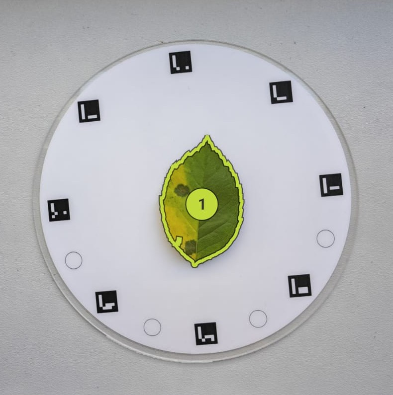

# Petiole SDK for TypeScript

[](https://www.npmjs.com/package/@petiole/sdk)
[](https://nodejs.org)
[](./LICENSE)
[](https://docs.npmjs.com/generating-provenance-statements)
[](https://github.com/getpetiole/petiole-sdk-typescript/actions/workflows/ci.yml)

**Measure plant leaves from a photo, through an API.**

Petiole detects and outlines leaves in an image and measures them in real
units, such as leaf area in cm², using a calibration pad in the photo as a
reference. This SDK is the official way to call the Petiole API from
TypeScript and JavaScript.

<p align="center"></p>

[Documentation](https://platform.petiole.pro/docs/en) ·
[Platform](https://platform.petiole.pro) ·
[Changelog](./CHANGELOG.md) ·
[Report an issue](https://github.com/getpetiole/petiole-sdk-typescript/issues) ·
[Contact us](mailto:support@petioleapp.com)

---

## Contents

- [Features](#features)
- [Requirements](#requirements)
- [Installation](#installation)
- [Quick start](#quick-start)
- [Authentication](#authentication)
- [Models](#models)
- [Workflows and analyses](#workflows-and-analyses)
- [Uploads](#uploads)
- [Webhooks](#webhooks)
- [Error handling](#error-handling)
- [Retries, timeouts and cancellation](#retries-timeouts-and-cancellation)
- [TypeScript types](#typescript-types)
- [For organisations](#for-organisations)
- [Versioning](#versioning)
- [Security](#security)
- [Contributing](#contributing)
- [Licence](#licence)

## Features

- **Leaf detection and segmentation.** Find leaves in a photo and get their
  precise outlines (SAM 2.1).
- **Measurement workflows.** Turn a photo into calibrated measurements, such
  as leaf area in cm², with `leaf_area_v1`.
- **Production-ready by default.** Automatic retries, idempotent requests,
  per-request timeouts and cancellation.
- **Signed webhooks.** Get notified when an analysis finishes, with signature
  verification built in.
- **Fully typed.** Types are generated from the API's OpenAPI specification.
- **No dependencies.** Uses only the standard `fetch` and Web Crypto APIs, so
  it runs on Node.js, Deno, Bun and edge runtimes.

## Requirements

- Node.js 22 or later (tested on Node.js 22 and 24), or another runtime with
  `fetch` and Web Crypto
- A Petiole API key from the [Petiole platform](https://platform.petiole.pro)

## Installation

```sh
npm install @petiole/sdk
```

## Quick start

1. Create an API key under **Keys & access** in the
   [Petiole platform](https://platform.petiole.pro). Limit it to the
   endpoints your code needs and give it an expiry date.
2. Set it as an environment variable:

   ```sh
   export PETIOLE_API_KEY=ptl_live_…
   ```

3. Take a photo of a leaf on the Petiole calibration pad and run:

```ts
import { Petiole } from "@petiole/sdk";
import { imageFromPath } from "@petiole/sdk/node";

const petiole = new Petiole(); // reads PETIOLE_API_KEY
const photo = await imageFromPath(process.argv[2] ?? "leaf.jpg");

// 1. Detect leaves: bounding boxes with confidence scores.
const found = await petiole.models.predict("leaf-detector", photo);
console.log(`Leaves found: ${found.detections.length} (${found.durationMs} ms)`);

// 2. Outline them: SAM 2.1 segments the detected boxes.
const outlined = await petiole.models.predict("sam2-small", photo, {
  boxes: found.detections.slice(0, 50).map((leaf) => leaf.bbox),
});
console.log(`Outlined: ${outlined.detections.length}`);

// 3. Measure them: leaf area in cm², calibrated by the pad.
const measured = await petiole.analyze(photo, { workflow: "leaf_area_v1" });

if (measured.status === "succeeded") {
  for (const leaf of measured.result?.objects ?? []) {
    console.log(`${leaf.objectId}: ${leaf.properties.area_cm2} cm²`);
  }
} else {
  console.log(`Not measured: ${measured.reason} (${measured.code})`);
}
```

Example output:

```text
Leaves found: 1 (985 ms)
Outlined: 1
ana_01M6YAZR69QA1YPGXJG6SX3XEC:leaf:det_001: 53.08 cm²
```

## Authentication

The client reads your key from the `PETIOLE_API_KEY` environment variable,
or you can pass it directly, as you must on runtimes without `process.env`,
such as some edge runtimes:

```ts
const petiole = new Petiole({ apiKey: process.env.PETIOLE_API_KEY });
```

| Key prefix | Environment | Base URL |
| --- | --- | --- |
| `ptl_live_` | Production | `https://api.petiole.pro` (default) |
| `ptl_test_` | Staging | `https://api-staging.petiole.pro` |

To use staging, set `baseUrl` or the `PETIOLE_BASE_URL` environment variable:

```ts
const petiole = new Petiole({ baseUrl: "https://api-staging.petiole.pro" });
```

### Keeping your key safe

- **Keep API keys on your server.** A key is shown only once, when you create
  it. Never put it in browser code, where any script on the page can read
  it. The API does not allow cross-origin browser requests.
- **Calling from a web app.** Route requests through your own backend. The
  SDK can be bundled into a web page with no key, pointing at your own
  endpoint, which adds the key on the server:

  ```ts
  const petiole = new Petiole({ apiKey: null, baseUrl: "/api" }); // calls /api/v1/…
  ```

- **Limiting exposure.** Your organisation's daily quotas, and a key's own
  limit if you give it one, cap the cost of a leaked key. If a key is exposed, revoke it under **Keys & access**. A
  revoked key stops working within a minute.

## Models

Models **detect** objects. They do not measure anything; measurements come
from [workflows](#workflows-and-analyses).

```ts
const { data } = await petiole.models.list();            // models your key can see; callable: false ones run only in workflows
const model = await petiole.models.get("leaf-detector");

const prediction = await petiole.models.predict("leaf-detector", photo, {
  confThreshold: 0.25, // minimum confidence score to return
  maxDetections: 100,
});
```

**Coordinates.** Boxes and outlines are given as fractions (0 to 1) of the
image as displayed upright, with EXIF orientation applied. To draw them at
any size, multiply by the displayed width and height.

**Scores.** A `score` is the model's confidence. It is not a calibrated
probability.

**Cold starts.** A model that has been idle can take up to a minute to start.
`predict` waits for it automatically, for up to two minutes (`maxWaitMs`).
To avoid the delay, wake the model early, for example when a user opens
your upload screen:

```ts
const { status } = await petiole.models.status("leaf-detector"); // "ready", "starting" or "unavailable"; also wakes the model
await petiole.models.waitUntilReady("leaf-detector");            // wakes the model and waits until it is ready
```

## Workflows and analyses

An **analysis** runs an image through a **workflow**, such as
`leaf_area_v1`, and returns the measured objects with their properties. Units
for each property are listed by `petiole.objectTypes.get()`.

`petiole.analyze()` submits the image, waits for the analysis to finish and
returns the result in a single call.

An analysis can end in one of three states:

| Status | Meaning | How the SDK reports it |
| --- | --- | --- |
| `succeeded` | The image was measured. | The result contains `objects`. |
| `cancelled` | The image could not be measured, for example `no_markers` when the calibration pad is not visible. | Returned as a normal result with a `code` and `reason`. |
| `failed` | A technical error occurred. | `petiole.analyze()` throws `AnalysisFailedError`; `analyses.wait()` and `analyses.result()` return it with a `code` and `reason`. |

### Step-by-step control

For long-running or batch processing, create the analysis, then wait for it
or receive a webhook:

```ts
const created = await petiole.analyses.create(photo, {
  workflow: "leaf_area_v1",
  webhookUrl: "https://example.com/hooks/petiole", // optional; defaults to your organisation's endpoint
  metadata: { plot: "B4" },                        // stored with the analysis and returned as-is
});

await petiole.analyses.wait(created.id, {
  onStatus: (analysis) => console.log(analysis.status, analysis.step?.name),
});

const result = await petiole.analyses.result(created.id);

// Iterate over past analyses; pagination is handled for you.
for await (const analysis of petiole.analyses.iterate({ status: "succeeded" })) {
  console.log(analysis.id, analysis.finishedAt);
}
```

## Uploads

You can send a photo directly in the request, as above, or upload it first.
An upload is sent once to a signed URL and can then be used by ID for
predictions and analyses, as many times as you need, for 24 hours. Uploads
are recommended for large images and mobile apps.

```ts
const upload = await petiole.uploads.upload(photo);

await petiole.models.predict("leaf-detector", { uploadId: upload.id });
await petiole.analyze({ uploadId: upload.id }, { workflow: "leaf_area_v1" });
```

> **Note:** uploads must be made from a server or mobile app. They are not
> supported directly from your own web pages.

## Webhooks

Analysis events are delivered to the analysis's `webhookUrl`, or to your
organisation's default endpoint, and signed with your webhook secret.
Always verify the signature against the **raw request body**, before
parsing it:

```ts
import { SIGNATURE_HEADER, verifyWebhook, WebhookSignatureError } from "@petiole/sdk";

export async function POST(request: Request): Promise<Response> {
  try {
    const event = await verifyWebhook({
      payload: await request.text(),
      signature: request.headers.get(SIGNATURE_HEADER),
      secret: process.env.PETIOLE_WEBHOOK_SECRET!,
    });

    if (event.type === "analysis.succeeded") {
      // event.data is the analysis; fetch its result with petiole.analyses.result().
    }

    return new Response(null, { status: 204 });
  } catch (error) {
    if (error instanceof WebhookSignatureError) {
      return new Response(null, { status: 400 });
    }
    throw error;
  }
}
```

- **Replay protection.** Signatures older than five minutes are rejected.
- **At-least-once delivery.** A delivery that gets no 2xx response is
  retried with backoff for 24 hours, so the same event may arrive more than
  once. Use
  the event `id` to skip duplicates.
- **Rotating secrets.** During a rotation, pass both secrets:
  `secret: [oldSecret, newSecret]`.

## Error handling

All errors thrown by the SDK extend `PetioleError`. A call cancelled with an
`AbortSignal` rejects with the signal's reason instead.

| Error | Thrown when |
| --- | --- |
| `ApiError` | The API returned an error. Includes `status`, `code` (e.g. `not_found`, `quota_exceeded`), `detail`, `requestId` and, for `invalid_request`, field-level `errors`. |
| `AnalysisFailedError` | An analysis run by `petiole.analyze()` ended with status `failed` (a technical failure). |
| `ConnectionError` | The API could not be reached. |
| `TimeoutError` | A request or wait exceeded its time limit. |
| `UploadError` | An upload to the signed URL was rejected. |
| `WebhookSignatureError` | A webhook signature could not be verified. |

```ts
import { ApiError } from "@petiole/sdk";

try {
  await petiole.analyze(photo, { workflow: "leaf_area_v1" });
} catch (error) {
  if (error instanceof ApiError) {
    console.error(error.status, error.code, error.detail, `request: ${error.requestId}`);
  }
  throw error;
}
```

Please include the `requestId` when contacting support. New error codes may
be added over time, so handle unknown codes by their HTTP `status`.

## Retries, timeouts and cancellation

- **Idempotency.** Every `POST` request carries an `Idempotency-Key` that
  stays the same across retries, so a retry never creates a duplicate
  analysis. To safely repeat a call yourself, pass your own
  `{ idempotencyKey }`; it is honoured for 24 hours.
- **Automatic retries.** Failed connections, timeouts, `rate_limited`,
  `service_unavailable`, `internal_error`, `idempotency_key_in_use` and bare
  408, 502, 503 and 504 responses are retried twice by default
  (`maxRetries`). A `Retry-After` of up to 60 seconds is waited for; a longer
  one is thrown at once. `quota_exceeded` (which resets at midnight UTC) and
  `concurrency_limit_exceeded` are never retried. A model that is starting
  is waited for separately, up to `maxWaitMs`.
- **Timeouts.** Each API request attempt may take up to 90 seconds
  (`timeoutMs`), and an upload to its signed URL at least 300 seconds. The
  API itself responds within 60 seconds.
- **Cancellation.** Every method accepts an `AbortSignal`, which cancels the
  request together with any pending retries and waits.

Options can be set for every call on the client, or for a single call as the
last argument:

```ts
const petiole = new Petiole({ maxRetries: 3, timeoutMs: 60_000 });

const controller = new AbortController();
await petiole.analyze(photo, { workflow: "leaf_area_v1", signal: controller.signal });
```

## TypeScript types

The API's types are included and generated from its OpenAPI specification,
including `Prediction`, `Detection`, `Box`, `AnalysisResult`, `ResultObject`
and `Problem`.

```ts
import type { Detection, ResultObject } from "@petiole/sdk";
```

## For organisations

Petiole works with growers, breeders, research institutes and agri-food
businesses. If you are evaluating Petiole for your organisation, we can
help with:

- **Pilots** on your own crops and imaging set-up
- **Higher quotas** and concurrency limits
- **Data protection and security questions** for your procurement or IT review
- **Integration support** for your team

<!-- TODO: once confirmed, add short factual answers here, for example:
- Data location: images and results are stored in …
- Retention: uploads expire after 24 hours; analyses are kept for …
- Model training: customer images are / are not used to train models
- Support: response times, status page URL
Only list certifications Petiole actually holds. -->

Contact us at [support@petioleapp.com](mailto:support@petioleapp.com).

## Versioning

This SDK follows [Semantic Versioning](https://semver.org) and targets
version 1 of the Petiole API. Until version 1.0.0, minor releases may
include breaking changes; every change is recorded in the
[changelog](./CHANGELOG.md).

## Security

Please do not report security vulnerabilities in public issues. Report them
privately as described in our
[security policy](https://github.com/getpetiole/.github/blob/main/SECURITY.md).

## Contributing

The source code is at
[getpetiole/petiole-sdk-typescript](https://github.com/getpetiole/petiole-sdk-typescript).
It is copied from Petiole's platform repository at each release, where it is
generated from the API specification and tested against the API, and
published to npm from here.
Issues and pull requests are welcome; merged changes are included in the
next release.

```sh
npm ci
npm run generate       # regenerate src/generated from openapi.yaml
npm run typecheck
npm test               # unit tests against a mocked fetch
npm run test:contract  # every call against a Prism mock of openapi.yaml (Node.js 24)
npm run build && npm run check:browser
```

## Licence

[MIT](./LICENSE) © 2026 Petiole LTD
